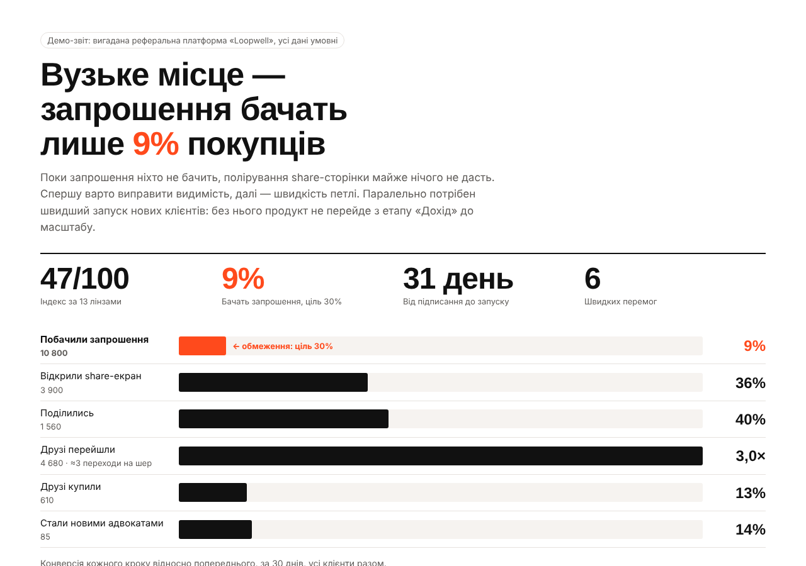
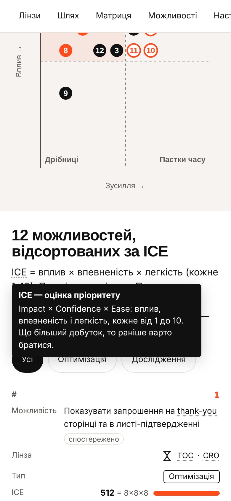

# Product Lens Audit

A Claude skill that audits a digital product - a website, web app, SaaS flow, landing page or mobile app screenshots - through **13 strategy lenses** and turns the findings into a visual, evidence-based report with a prioritized plan.

Each lens asks a different question. The value is in seeing what one lens misses:

| Group | Lenses |
|---|---|
| Improve the existing system | CRO, Theory of Constraints, Kaizen |
| Are we solving the right problem? | Jobs to Be Done, continuous discovery, service design |
| Grow differently | Growth loops, product-led growth, platform / ecosystem |
| Change the game | Business-model innovation, Blue Ocean |
| Protect long-term value | Reliability engineering, privacy / ethical design |

Supporting tools: Lean Analytics stages, AARRR, LIFT, Value Proposition Canvas, Hook model, HEART, Kano, Cynefin, ICE, opportunity solution tree, pre-mortem.



## What you get

- **The main constraint first.** The headline names the single step that limits the whole system, with its number.
- **Product stage** (Lean Analytics) and a warning when the team is working on the wrong stage, for example selling ads before readers come back.
- **Radar of 13 lenses**, a service-blueprint journey, and an impact-effort matrix.
- **Opportunities ranked by ICE**, each labelled *observed* or *hypothesis*, split into optimize vs explore.
- **A full plan for every opportunity**: why it is there, concrete steps, metric, effort and risk. The top 3 also get alternatives considered, an experiment with a success threshold, a pre-mortem and copy variants.
- **Tooltips for every term** (CTR, ICE, JTBD, LTV...): hover on desktop, tap on phone or tablet.
- **Honest confidence**: which data sources were used, which were missing, and the answers to the start questions.

<p>


</p>

## How it works

1. **Checks connected data sources** - browser, GA4, Search Console, Ahrefs, Similarweb, support, CRM - and marks each as used, partial or missing. It never invents numbers to fill a gap.
2. **Asks up to 4 quick questions**, each one skippable: the main customer, the goal for the quarter, what data you can share, and what you have already tried.
3. **Walks the product** and reads your data. Dashboard screenshots work too, and it flags polluted analytics such as a high Direct share or bot cities.
4. **Applies the lenses**, ties every finding to evidence, and prioritizes the findings with ICE.
5. **Builds the report** from a template, then **checks that it renders** on desktop, tablet and phone (`scripts/check_report.py`) before delivering it.

## Install

### Claude Code (terminal, desktop app, VS Code)

```
/plugin marketplace add artemhorbenko/product-lens-audit
/plugin install product-lens-audit@product-lens-audit
```

Then ask, for example: *"Run a lens audit of example.com, the goal is more trial signups"*.

### Claude app (claude.ai, desktop, mobile)

1. Download `product-lens-audit-skill.zip` from the [latest release](https://github.com/artemhorbenko/product-lens-audit/releases/latest).
2. Make sure code execution is on (Free, Pro, Max: Settings → Capabilities).
3. Go to **Customize → Skills**, click **+**, then **Create skill → Upload a skill**, and choose the ZIP.

See Anthropic's guide: [Use skills in Claude](https://support.claude.com/en/articles/12512180-use-skills-in-claude). Skills you enable in Claude also load in Claude Code when you sign in with the same account.

### Any other agent that reads SKILL.md

Copy `plugins/product-lens-audit/skills/product-lens-audit/` into your agent's skills folder.

## Better results with data

The skill works with just a URL, but evidence makes the plan sharper. Connect what you have, read-only:

| Data | Options |
|---|---|
| Browser | Claude in Chrome, or any browser tool |
| GA4 | Google's official GA4 MCP server, or screenshots |
| Search Console | A community GSC MCP server, Ahrefs (GSC tools), or screenshots |
| SEO / market | Ahrefs, Semrush, Similarweb connectors |
| Support / sales | Intercom, Zendesk, HubSpot - or paste the lost-deal reasons |

## Render check

```
pip install playwright && playwright install chromium
python plugins/product-lens-audit/skills/product-lens-audit/scripts/check_report.py report.html --out ./report-check
```

The script fails on page errors, sideways scroll, empty charts, tooltips that don't open on hover or tap, broken phone table cells, and filters that break the table. It also saves screenshots of every view, including dark mode.

## Privacy and safety

- Data sources are used read-only. The skill does not submit forms, payments or messages on a product it is auditing.
- It never invents numbers, testimonials, urgency or guarantees, and it does not recommend dark patterns.
- The report is one self-contained HTML file; nothing is sent anywhere by the report itself.

## Repository layout

```
.claude-plugin/marketplace.json        marketplace catalog (this repo)
plugins/product-lens-audit/
  .claude-plugin/plugin.json
  skills/product-lens-audit/
    SKILL.md                           the process
    references/report-spec.md          report sections, tooltips, mobile rules
    assets/report-template.html        finished demo report (fictional "Loopwell")
    scripts/check_report.py            headless render check
docs/                                  screenshots
```

## Credits

The skill borrows ideas, not text, from these sources: evidence discipline and anti-fabrication rules from the community `cro` skill (MIT, [as published in antigravity-awesome-skills](https://github.com/sickn33/antigravity-awesome-skills/tree/main/skills/cro)); experiments with risk type and success threshold from Paweł Huryn's opportunity solution tree skill (after Teresa Torres); the LIFT model (WiderFunnel); Lean Analytics (Croll & Yoskovitz); the Hook model (Nir Eyal); HEART (Google); Blue Ocean Strategy (Kim & Mauborgne); Theory of Constraints (Goldratt); Jobs to Be Done (Christensen, Moesta).

## License

MIT - see [LICENSE](LICENSE).

---

## Українською

**Product Lens Audit** - скіл для Claude, який аналізує цифровий продукт через 13 лінз: CRO, теорія обмежень, Kaizen, JTBD, discovery, service design, петлі росту, PLG, платформа, бізнес-модель, Blue Ocean, надійність і приватність. На виході ви отримуєте візуальний звіт із головним обмеженням, етапом продукту, пріоритизованими можливостями та детальним планом. Біля кожної знахідки є доказ, а кожен термін має підказку.

Встановлення в Claude Code:

```
/plugin marketplace add artemhorbenko/product-lens-audit
/plugin install product-lens-audit@product-lens-audit
```

Для Claude app завантажте ZIP з [останнього релізу](https://github.com/artemhorbenko/product-lens-audit/releases/latest), потім **Customize → Skills → + → Create skill → Upload a skill**.
