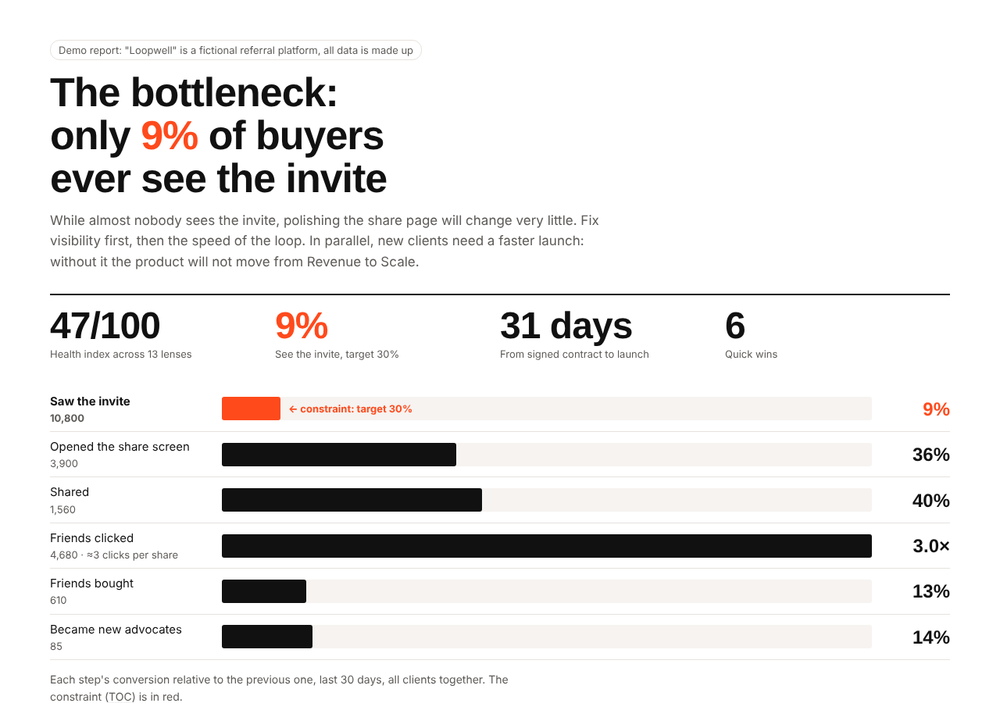
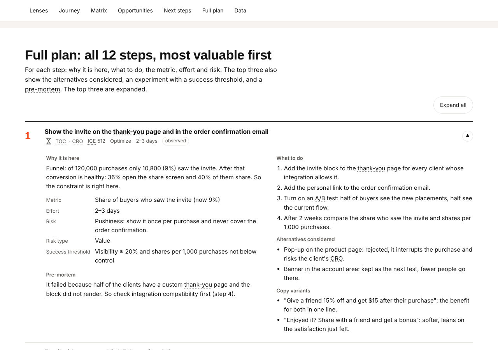
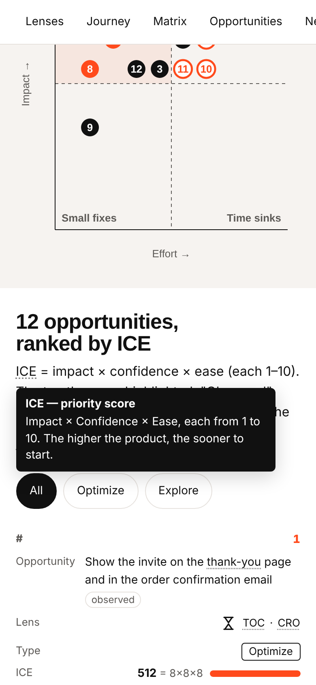

# Product Lens Audit

A Claude skill that audits a digital product - a website, web app, SaaS flow, landing page or mobile app screenshots - through **13 strategy lenses** and turns the findings into a visual, evidence-based report with a prioritized plan.

Each lens asks a different question. The value is in seeing what one lens misses:

**Live demo:** [English](https://claude.ai/artifact/FyKs3ePt4fFF1xNWq3QDah) · [Ukrainian](https://claude.ai/artifact/NF3ziLaGy95NQbqDwN6AAJ) (fictional product "Loopwell", made-up data).

### The 13 lenses

| Group | Lens | The question it asks |
|---|---|---|
| Improve the existing system | **CRO** (conversion rate optimization) | Where do people drop out, and why? |
| | **Theory of Constraints** | Which single step limits the whole system right now? |
| | **Kaizen** | What internal work is slow, manual or error-prone? |
| Are we solving the right problem? | **Jobs to Be Done** | What progress is the customer really hiring the product for? |
| | **Continuous discovery** | What evidence loops exist, and what should we ask next? |
| | **Service design** | Does the whole experience hold together across teams? |
| Grow differently | **Growth loops** | Does one successful action create the next? |
| | **Product-led growth** | Can the product itself acquire, activate and expand users? |
| | **Platform / ecosystem** | Could partners, integrations or network effects add value? |
| Change the game | **Business-model innovation** | What if delivery, pricing or ownership changed? |
| | **Blue Ocean** (ERRC) | What to eliminate, reduce, raise or create vs. competitors? |
| Protect long-term value | **Reliability** | Are critical paths monitored and safe to change? |
| | **Privacy / ethical design** | Any dark patterns, fake urgency or needless data collection? |

### Supporting concepts

- **Product stage:** Lean Analytics (empathy, stickiness, virality, revenue, scale), AARRR (pirate metrics), North Star metric.
- **Pages and value:** LIFT model, Value Proposition Canvas, Kano model.
- **Retention and growth:** Hook model, network effects, loop coefficient and cycle time.
- **Choosing metrics and approach:** HEART, Cynefin (optimize vs explore), LTV/CAC, incrementality.
- **Prioritizing and planning:** ICE scoring, observed vs hypothesis labels, opportunity solution tree, experiment risk types (value, usability, viability, feasibility), success thresholds, pre-mortem, instrumentation gaps.
- **Journey:** service blueprint.



## What you get

- **The main constraint first.** The headline names the single step that limits the whole system, with its number.
- **Product stage** (Lean Analytics) and a warning when the team is working on the wrong stage, for example selling ads before readers come back.
- **Radar of 13 lenses**, a service-blueprint journey, and an impact-effort matrix.
- **Opportunities ranked by ICE**, each labelled *observed* or *hypothesis*, split into optimize vs explore.
- **A full plan for every opportunity**: why it is there, concrete steps, metric, effort and risk. The top 3 also get alternatives considered, an experiment with a success threshold, a pre-mortem and copy variants.
- **Tooltips for every term** (CTR, ICE, JTBD, LTV...): hover on desktop, tap on phone or tablet.
- **Honest confidence**: which data sources were used, which were missing, and the answers to the start questions.

<p>


</p>

## How it works

1. **Checks connected data sources** - browser, GA4, Search Console, Ahrefs, Similarweb, support, CRM - and marks each as used, partial or missing. It never invents numbers to fill a gap.
2. **Asks up to 4 quick questions**, each one skippable: the main customer, the goal for the quarter, what data you can share, and what you have already tried.
3. **Walks the product** and reads your data. Dashboard screenshots work too, and it flags polluted analytics such as a high Direct share or bot cities.
4. **Applies the lenses**, ties every finding to evidence, and prioritizes the findings with ICE.
5. **Writes the audit as one `audit.json`**, validates it (`scripts/validate_audit.py`: every finding has evidence, every KPI number has a source, the top 3 have alternatives and a pre-mortem), builds the page (`scripts/build_report.py`), then **checks that it renders** on desktop, tablet and phone (`scripts/check_report.py`) before delivering it. Claude writes only data; the template draws everything, so a report costs far fewer tokens.

## Install

### Claude Code (terminal, desktop app, VS Code)

```
/plugin marketplace add artemhorbenko/product-lens-audit
/plugin install product-lens-audit@product-lens-audit
```

Then ask, for example: *"Run a lens audit of example.com, the goal is more trial signups"*.

### Claude app (claude.ai, desktop, mobile)

1. Download `product-lens-audit-skill.zip` from this repository ([direct download](https://github.com/artemhorbenko/product-lens-audit/raw/main/product-lens-audit-skill.zip)).
2. Make sure code execution is on (Free, Pro, Max: Settings → Capabilities).
3. Go to **Customize → Skills**, click **+**, then **Create skill → Upload a skill**, and choose the ZIP.

See Anthropic's guide: [Use skills in Claude](https://support.claude.com/en/articles/12512180-use-skills-in-claude). Skills you enable in Claude also load in Claude Code when you sign in with the same account.

### Any other agent that reads SKILL.md

Copy `plugins/product-lens-audit/skills/product-lens-audit/` into your agent's skills folder.

## Better results with data

The skill works with just a URL, but evidence makes the plan sharper. Connect what you have, read-only:

| Data | Options |
|---|---|
| Browser | Claude in Chrome, or any browser tool |
| GA4 | Google's official GA4 MCP server, or screenshots |
| Search Console | A community GSC MCP server, Ahrefs (GSC tools), or screenshots |
| SEO / market | Ahrefs, Semrush, Similarweb connectors |
| Support / sales | Intercom, Zendesk, HubSpot - or paste the lost-deal reasons |

## Build and check a report yourself

```
S=plugins/product-lens-audit/skills/product-lens-audit
python $S/scripts/validate_audit.py audit.json          # data and rules, standard library only
python $S/scripts/build_report.py audit.json report.html
pip install playwright && playwright install chromium
python $S/scripts/check_report.py report.html --out ./report-check
```

Start from `$S/assets/example-audit.json`; the shape is in `$S/references/audit.schema.json`. The render check fails on page errors, sideways scroll, empty charts, overlapping labels, tooltips that don't open on hover or tap, broken phone table cells, and filters that break the table. It also saves screenshots of every view, including dark mode.

## Privacy and safety

- Data sources are used read-only. The skill does not submit forms, payments or messages on a product it is auditing.
- It never invents numbers, testimonials, urgency or guarantees, and it does not recommend dark patterns.
- The report is one self-contained HTML file; nothing is sent anywhere by the report itself.

## Repository layout

```
.claude-plugin/marketplace.json        marketplace catalog (this repo)
plugins/product-lens-audit/
  .claude-plugin/plugin.json
  skills/product-lens-audit/
    SKILL.md                           the process
    references/lenses.md               the 13 lenses and how to score them
    references/data-sources.md         what to query in each data source, fallbacks, polluted-data signs
    references/report-spec.md          report sections, tooltips, mobile rules
    references/audit.schema.json       shape of the report data
    assets/report-template.html        the report page; renders from one JSON block
    assets/example-audit.json          full example (fictional "Loopwell")
    scripts/validate_audit.py          data and rule check
    scripts/build_report.py            audit.json -> report.html
    scripts/check_report.py            headless render check
evals/                                 test scenarios, trigger prompts, results log
docs/                                  screenshots
product-lens-audit-skill.zip           the skill packaged for upload to the Claude app
```

## Credits

The skill borrows ideas, not text, from these sources: evidence discipline and anti-fabrication rules from the community `cro` skill (MIT, [as published in antigravity-awesome-skills](https://github.com/sickn33/antigravity-awesome-skills/tree/main/skills/cro)); experiments with risk type and success threshold from Paweł Huryn's opportunity solution tree skill (after Teresa Torres); the LIFT model (WiderFunnel); Lean Analytics (Croll & Yoskovitz); the Hook model (Nir Eyal); HEART (Google); Blue Ocean Strategy (Kim & Mauborgne); Theory of Constraints (Goldratt); Jobs to Be Done (Christensen, Moesta).

## License

MIT - see [LICENSE](LICENSE).

---

## Українською

**Product Lens Audit** - скіл для Claude, який аналізує цифровий продукт через 13 лінз: CRO, теорія обмежень, Kaizen, JTBD, discovery, service design, петлі росту, PLG, платформа, бізнес-модель, Blue Ocean, надійність і приватність. На виході ви отримуєте візуальний звіт із головним обмеженням, етапом продукту, пріоритизованими можливостями та детальним планом. Біля кожної знахідки є доказ, а кожен термін має підказку.

**Демо-звіт:** [українською](https://claude.ai/artifact/NF3ziLaGy95NQbqDwN6AAJ) · [англійською](https://claude.ai/artifact/FyKs3ePt4fFF1xNWq3QDah) (вигаданий продукт «Loopwell», умовні дані).

**13 лінз у 5 групах:**
- **Покращити систему:** CRO (де люди відпадають і чому), теорія обмежень (який один крок стримує всю систему), Kaizen (яка внутрішня робота повільна чи ручна).
- **Чи ту проблему ми розв'язуємо:** Jobs to Be Done (заради якого прогресу клієнт «наймає» продукт), continuous discovery (які є петлі доказів), service design (чи тримається весь досвід між командами).
- **Рости інакше:** петлі росту (чи запускає одна дія наступну), PLG (чи залучає продукт сам), платформа й екосистема (партнери, інтеграції, мережеві ефекти).
- **Змінити гру:** інновація бізнес-моделі, Blue Ocean (ERRC).
- **Захистити цінність:** надійність, приватність і етичний дизайн.

**Допоміжні концепції:** Lean Analytics, AARRR, North Star, LIFT, Value Proposition Canvas, модель Кано, Hook model, мережеві ефекти, HEART, Cynefin, LTV/CAC, інкрементальність, ICE, «спостережено / гіпотеза», opportunity solution tree, типи ризику експерименту, поріг успіху, pre-mortem, прогалини вимірювання, service blueprint.

Встановлення в Claude Code:

```
/plugin marketplace add artemhorbenko/product-lens-audit
/plugin install product-lens-audit@product-lens-audit
```

Для Claude app завантажте ZIP з репозиторію ([пряме завантаження](https://github.com/artemhorbenko/product-lens-audit/raw/main/product-lens-audit-skill.zip)), потім **Customize → Skills → + → Create skill → Upload a skill**.
